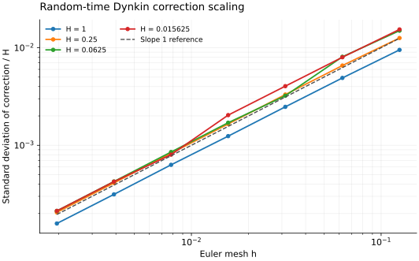

# Verification

These checks exercise the coupled estimator and feedback reconstruction. They do not execute a quantum computer, certify asymptotic complexity from finite data, or establish a quantum/classical hardware crossover. The analytical guarantees and their assumptions are stated in [Model and results](../science/model-and-results.md).

## Reproduce

From the repository root, install the recorded dependencies and run:

```bash
python -m pip install -r requirements.txt
python verification/check_random_time_coupling.py
python verification/check_closed_mean.py
OPENBLAS_NUM_THREADS=1 OMP_NUM_THREADS=1 python verification/classical_polymer_stress.py
python verification/check_resource_construction.py
```

Each numerical script regenerates its corresponding JSON file in this directory. The recorded runs used Python with NumPy 2.3.5 and SciPy 1.17.0. Random seeds are fixed in the scripts. The timing fields describe the available execution environment and are not portable performance estimates. The figure is regenerated from the recorded coupling data with `python verification/plot_coupling_scaling.py`, using Matplotlib 3.10.8.

| Check | What it probes | Recorded data |
|---|---|---|
| [Random-time coupling](check_random_time_coupling.py) | The mixed temporal-width / simulation-mesh correction estimate in a nonlinear additive-noise diffusion | [random_time_coupling_check.json](random_time_coupling_check.json) |
| [Closed-mean feedback](check_closed_mean.py) | Full Picard iteration, hierarchical reconstruction with bounded coefficient errors, and a distinct terminal observable | [closed_mean_results.json](closed_mean_results.json) |
| [Polymer comparison](classical_polymer_stress.py) | IID and randomized QMC particle estimates under the same finite-dimensional model, noise transformation and time mesh | [classical_polymer_stress_results.json](classical_polymer_stress_results.json) |
| [Resource constructions](check_resource_construction.py) | Exact finite checks of endpoint alignment, PRG parameters, hash addressing and clean reversible checkpoint bridges | [resource_construction_check.json](resource_construction_check.json) |

## Hosted mathematical content

The separate [hosted mathematics collector](hosted/references/hosted-rendering.md) compares every declared source expression with the actual commit-pinned GitHub rendering at two viewport widths. The read-only CI job preserves HTML, screenshots, MathML and source-bound reports, including failed comparisons. A complete capture uses all tracked Markdown pages. A deliberately restricted representative-page diagnostic does not establish full coverage.

Structural comparison, visual inspection and scientific verification answer different questions. A correct rendering does not establish a theorem, and a source-level proof review does not show what the reader sees on the hosting site.

## 1. The mixed correction estimate

The test uses
```math
dX_t=(-0.7\sin X_t+0.4v(t)\cos X_t)\,dt+0.8\,dW_t,
\qquad
g(x)=\sin x,
```
with the prescribed Lipschitz curve
```math
v(t)=0.2\sin(\pi t)+0.1\vert t-0.4\vert ,\qquad X_0=0.3,\quad T=1.
```

For each of four temporal support widths and seven Euler meshes, 24,000 samples share the random endpoint and fine/coarse Brownian increments. The final partial increment is included. The estimated standard-deviation slopes against the mesh size are:

| Temporal width $`H`$ | Fitted slope | Range of $`\mathrm{std}(\Delta)/(Hh)`$ |
|---:|---:|---:|
| 1 | 0.9871 | 0.0760–0.0808 |
| 1/4 | 0.9931 | 0.1006–0.1061 |
| 1/16 | 1.0295 | 0.1030–0.1292 |
| 1/64 | 1.0479 | 0.1027–0.1305 |



The curves are consistent with the proved $`O(Hh)`$ upper bound for this example. A fitted slope is not a proof, and the sample range does not certify a uniform constant over other inputs.

## 2. A complete feedback check with an exact answer

The validation model is
```math
dX_t=\lambda\,\mathbb E[\sin X_t]\,dt+\sigma\,dW_t,
\qquad X_0=x_0.
```

It is classically soluble. Writing $`X_t=\mu(t)+\sigma W_t`$, the exact solution for the selected $`x_0=0.4`$, $`\lambda=0.8`$, $`\sigma=0.7`$, $`T=1`$ is
```math
\mu(t)=2\arctan\!\left[
\tan(x_0/2)\exp\!\left\lbrace 
\frac{2\lambda}{\sigma^2}(1-e^{-\sigma^2t/2})
\right\rbrace 
\right],
\qquad
m(t)=e^{-\sigma^2t/2}\sin\mu(t).
```

The code performs complete global Picard reconstruction, adding deterministic coefficient errors bounded by the allocated tolerance. It checks the reconstruction error, slope bound and final output $`e^{-\sigma^2T/2}\cos\mu(T)`$. For requested errors $`2^{-4},2^{-6},2^{-8}`$, the observed terminal errors were approximately $`4.38\times10^{-6}`$, $`3.67\times10^{-6}`$, and $`5.44\times10^{-8}`$. A separate quadrature check compared the random-time generator identity with the same midpoint detail computed directly; its maximum discrepancy was $`1.41\times10^{-16}`$.

Expectations inside this check are computed analytically, rather than by amplitude estimation. The example tests feedback and readout bookkeeping. It is not an advantage example, a quantum gate simulation or evidence that a generic problem admits this exact mean closure.

## 3. A bounded classical polymer comparison

The supplied chain has 32 beads and 96 state coordinates, three nonorthogonal Fourier modes, $`T=1`$, and 32 Euler steps. Exact reflection symmetry sets the sine mean modes to zero; both methods use that simplification. Both also receive a Gaussian Rouse-mode initial sampler and Brownian-bridge/Rouse-mode noise ordering. The difference is IID normal input versus independently scrambled Sobol points transformed to normal input.

There are 20 independent runs or scramblings for each particle count. The empirical density-amplitude variances are:

| Particles | IID | Randomized QMC | IID / QMC |
|---:|---:|---:|---:|
| 64 | $`3.0652\times10^{-4}`$ | $`8.4331\times10^{-5}`$ | 3.63 |
| 128 | $`1.1035\times10^{-4}`$ | $`2.0119\times10^{-5}`$ | 5.48 |
| 256 | $`7.2617\times10^{-5}`$ | $`3.5998\times10^{-5}`$ | 2.02 |
| 512 | $`1.6916\times10^{-5}`$ | $`2.5444\times10^{-5}`$ | 0.66 |
| 1024 | $`1.8986\times10^{-5}`$ | $`3.1989\times10^{-6}`$ | 5.94 |

QMC gives useful variance reductions in most of these cases. Five-point fits give approximate variance slopes of $`-1.07`$ for IID and $`-0.91`$ for randomized QMC density estimation; the scattering slopes are approximately $`-0.98`$ and $`-1.04`$. Twenty replicates and five particle counts do not establish an asymptotic exponent or a reliable ordering at every count.

The nonlinear field is material. A single 2,048-particle reference starts at density amplitude 0.77466 and ends near 0.41420 with interactions, versus 0.76457 with the field switched off using the same driver. This reference is not an exact expectation.

The experiment measures randomization variance at a fixed mesh. It does not certify particle bias, time bias, physical model error, or optimality of the classical method. Multilevel QMC, regression and Rouse control variates, quadrature, Gaussian closures and tensor approximations remain relevant competitors. Their mathematical scope is discussed in [Classical comparison](../science/classical-comparison.md).

## 4. Finite resource constructions

The resource checker uses only the Python standard library. It checks the actual discrete constructions that close the finite-bit and memory arguments:

- Exact-rational normal-tail and quantization budgets for requested errors from $`2^{-2}`$ to $`2^{-64}`$.
- A total of 1,100 rational endpoint pairs, 42,924 mask comparisons, and the corresponding partial fine/coarse variance identities.
- Exhaustive pairwise independence of the specified affine Toeplitz hashes for one-, two- and three-bit blocks.
- Agreement of 4,032 individually addressed HashPRG blocks with the recursive generator definition.
- A total of 3,840 basis-input cases for checkpoint bridges, including noninvertible state transitions, arbitrary target registers, inverse schedules, cleaned scratch registers, exact leaf counts and classical tape travel.
- Exact PRG parameter inequalities and the first-/second-moment error transfers, including polynomially growing pointwise ranges.
- The amplitude-estimation bin budgets and the total coefficient error allowance.

All recorded checks pass. These finite cases help detect indexing, cleanup, alignment and constant-allocation errors; the general constructions and asymptotic claims still rest on the proofs in [Finite precision and circuits](../science/finite-precision-and-circuits.md) and [Memory and recomputation](../science/memory-and-recomputation.md). The checker does not generate an executable quantum SDE solver, simulate amplitude estimation or estimate physical fault-tolerant resources.

